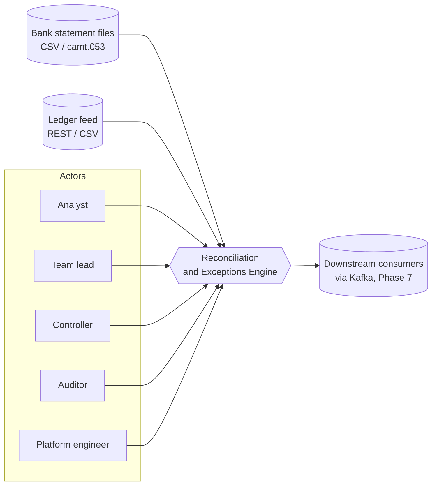
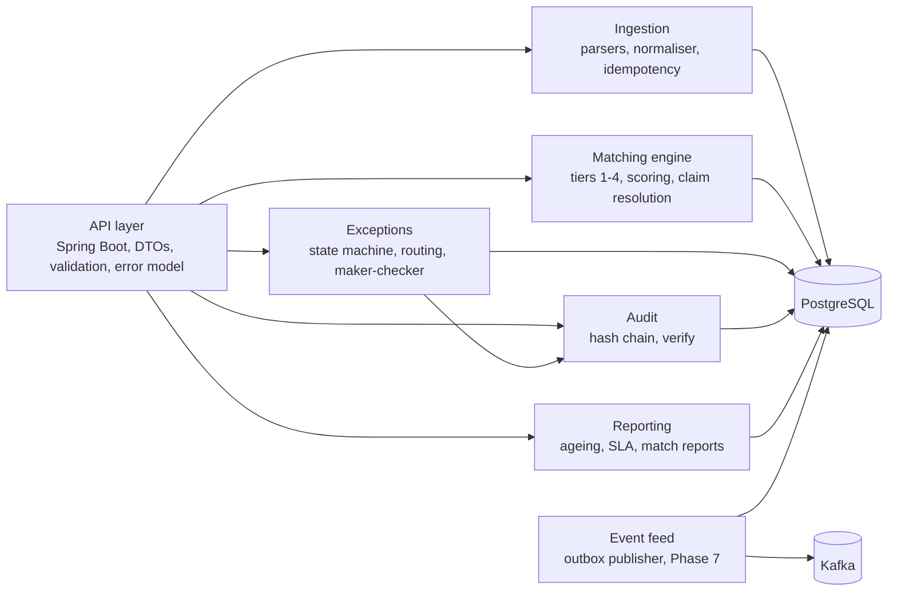
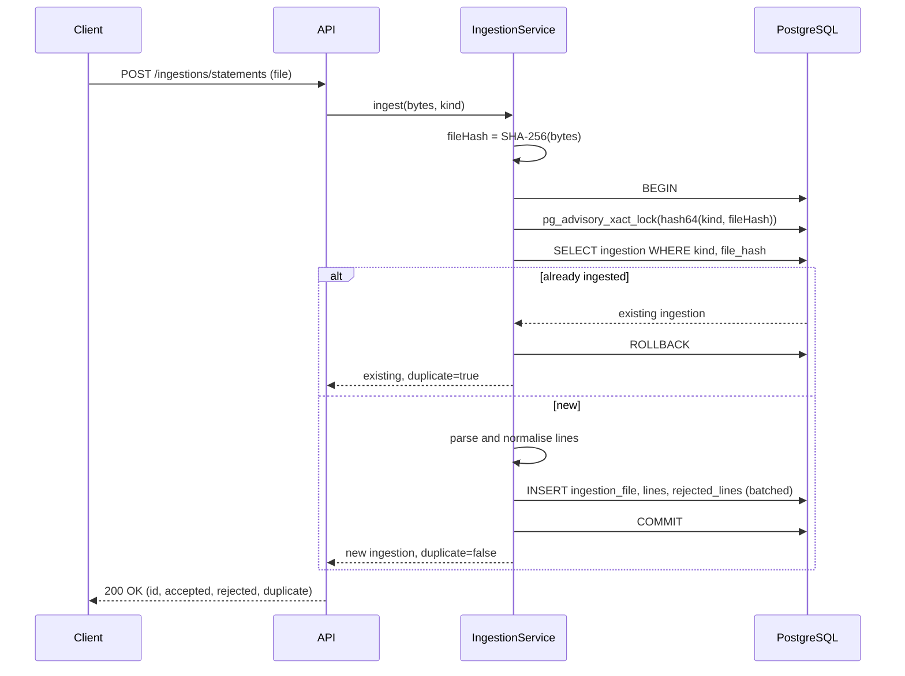
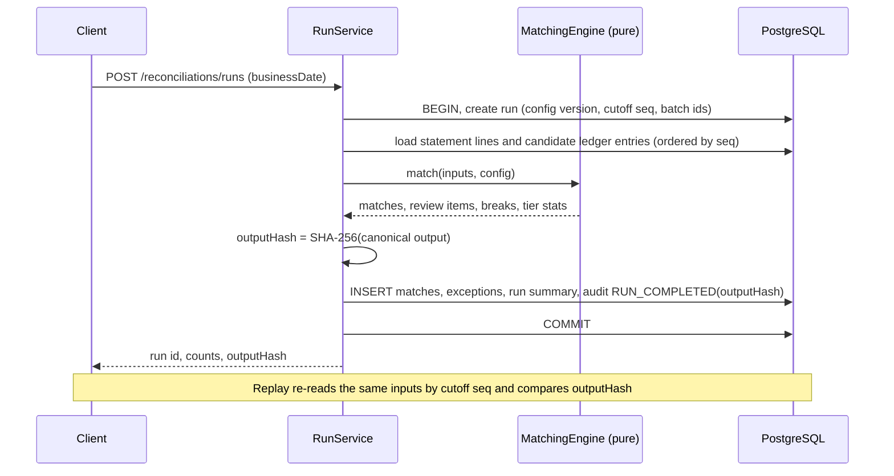
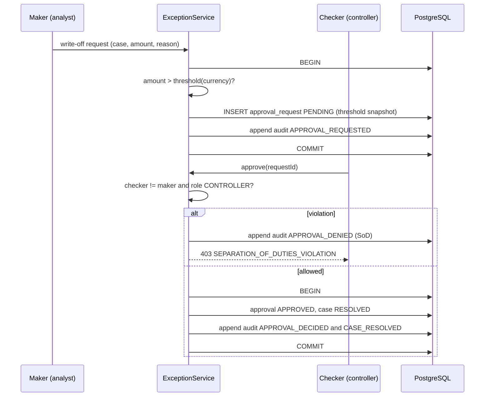
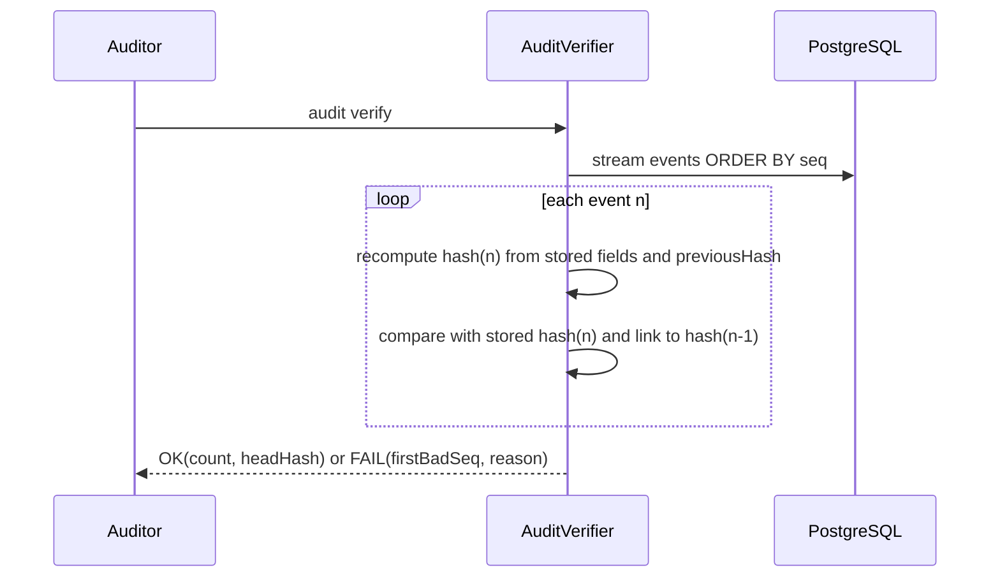
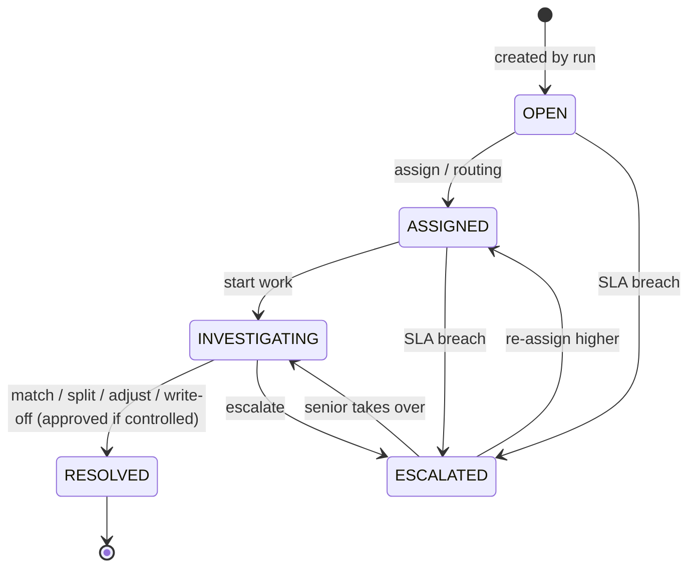

# Architecture

Status: **Proposal for Phase 0 review.** Diagrams are Mermaid so they render on GitHub and stay in version control. Requirements: [BRD](BRD.md), [FRD](FRD.md). Decisions: [ADRs](adr/).

## 1. Principles

1. **Simple topology, deep quality.** One deployable (a modular monolith) and one database. No microservices, no cache, no search engine. Kafka arrives only in Phase 7 behind an outbox.
2. **Pure core.** `domain` and `matching` are plain Java: no Spring, no JDBC, no JSON annotations. ArchUnit enforces it. This is what makes determinism, property testing and benchmarking cheap.
3. **PostgreSQL is the system of record** for inputs, outputs, exceptions, approvals, audit and outbox ([ADR-0005](adr/0005-postgresql-system-of-record-and-outbox.md)).
4. **Everything that matters is replayable.** Inputs are immutable and sequenced; runs record exactly what they consumed ([ADR-0003](adr/0003-deterministic-matching.md)).
5. **Audit in the same transaction** as the change it describes ([ADR-0004](adr/0004-hash-chained-audit-log.md)).

## 2. System context



## 3. Components

Seven components and one database, matching the BRD.



Work flows left to right: ingestion fills the canonical tables, matching consumes them and produces matches and exceptions, exceptions are worked by people. Reporting, audit verification and the event feed only read what the others wrote.

### 3.1 Package layout

```text
com.saumay.payments
├── domain                 plain Java, no framework imports
│   ├── money              Money, CurrencyCode, minor-unit arithmetic
│   ├── model              CanonicalLine, StatementLine, LedgerEntry, BusinessDate, ids
│   ├── cases              ExceptionCase, state machine, routing, SLA clock
│   ├── approval           ApprovalRequest, maker-checker policy
│   └── audit              AuditEvent, hash chain, verifier
├── matching               plain Java: tiers, scoring, candidate index, claim resolver, output hash
├── ingestion              plain Java: CSV and camt.053 parsers, normaliser (the only place BigDecimal is allowed)
├── application            use-case services and ports (repositories, Clock, ActorContext)
├── infrastructure
│   ├── persistence        JDBC adapters, Flyway migrations live in resources
│   ├── outbox             outbox writer and publisher (Phase 7)
│   └── metrics            Micrometer adapters
├── api                    Spring Boot controllers, DTOs, error mapping, security (Phase 8)
└── config                 Spring configuration and typed properties
```

ArchUnit rules (written in Phase 1, run on every build):

| Rule | Enforces |
| --- | --- |
| `domain..`, `matching..`, `ingestion..` depend on no `org.springframework..`, `jakarta..`, `java.sql..`, `com.fasterxml..` | Pure core |
| `domain..`, `matching..` and the normaliser output may not use `double`, `float`, `Double`, `Float` | NFR-05 |
| `java.math.BigDecimal` only inside `ingestion.normalise..` | Money enters the system as text and leaves as `long` |
| `domain..` and `matching..` may not call `System.currentTimeMillis`, `Instant.now()`, `LocalDate.now()`, `Random`, `UUID.randomUUID()` | Determinism |
| `api..` may not be referenced from any other package | Layering |
| `infrastructure..` may not be referenced from `domain`, `matching`, `application` | Dependency inversion |

## 4. Key sequences

### 4.1 Idempotent ingestion



A crash before `COMMIT` leaves nothing behind, so a retry starts clean. The advisory lock serialises concurrent identical uploads; the unique constraint on `(kind, file_hash)` is the final backstop.

### 4.2 Reconciliation run



### 4.3 Maker-checker



### 4.4 Audit verification



## 5. Exception state machine



Eight legal transitions, all others rejected. `RESOLVED` is terminal (Open question Q-08).

## 6. Domain concepts and what gets persisted

Not every concept deserves a table. The rule: persist what must survive a restart, be queried, or be proven to an auditor.

| Concept | Persisted? | Decision and reason |
| --- | --- | --- |
| IngestionFile / IngestionBatch | Yes, one table | Idempotency anchor and provenance. `IngestionBatch` and `IngestionFile` are the same thing in v1: one file is one batch. Merged to avoid a pointless join |
| StatementLine, LedgerEntry | Yes, `statement_line`, `ledger_entry` | Immutable inputs. Separate tables because their lifecycles and indexes differ, same canonical columns |
| RejectedLine | Yes | Data-quality observability (never silently dropped) |
| ReconciliationRun | Yes | First-class, carries cut-off, config version, output hash |
| Match, MatchCandidate | Run matches yes (`run_match`, `run_match_line`, V3); manual matches as `line_claim` rows; candidates are **not** copied into cases | A case reads its candidates from the run's `run_exception_line` (role `CANDIDATE`) instead of duplicating them; showing them in the case view is deferred |
| ExceptionCase | Yes, `exception_case` (V4) | The working object: mutable, optimistic `version`, guarded by a trigger that also holds identity, amount and SLA columns immutable |
| ExceptionAssignment | Yes, `case_assignment`, append-only (V4) | Original owner must stay on record |
| ExceptionComment | Yes, `case_comment` and the timeline `case_activity`, both append-only (V4) | Activity timeline; interim record until the audit chain exists (Phase 5) |
| ExceptionAttachment | Metadata only, `case_attachment` (V4) | Table and immutability trigger built; no endpoint writes to it yet |
| Match claim | Yes, `line_claim` (V5 to V7) | Append-only ledger of `CLAIM` and `RELEASE` rows; one active claim per line, enforced by a trigger (ADR-0009). Replaces the proposed persistent `match` state |
| ApprovalRequest / ApprovalDecision | Yes, one table | A request has at most one decision; two tables would only add a join. Decision columns are nullable until decided |
| AuditEvent | Yes, append-only | The evidence |
| MatchingConfiguration (ReconciliationRule, thresholds) | Yes, versioned rows | Each change is a new immutable version, audited |
| SlaPolicy | Yes, inside the configuration version | Versioned with the rest of the business configuration |
| SlaClock, SlaBreach | **No** | Derived: computed from `created_business_date`, priority and the as-of date. Storing it would create a second source of truth that can drift. Breach is recorded as an audit event and a state change to `ESCALATED` |
| User, Role | Phase 8 | Until then an `ActorContext` port supplies an identity (Q-13) |
| OutboxEvent | Yes, Phase 7 | Transactional outbox |

## 7. Database design (proposal)

PostgreSQL, Flyway migrations. Money columns are `bigint` minor units with a `char(3)` currency; no `numeric` and no `float` for money anywhere.

```mermaid
erDiagram
    INGESTION_FILE ||--o{ STATEMENT_LINE : contains
    INGESTION_FILE ||--o{ LEDGER_ENTRY : contains
    INGESTION_FILE ||--o{ REJECTED_LINE : rejects
    RECONCILIATION_RUN ||--o{ RECONCILIATION_RUN_STATEMENT_BATCH : reconciles
    INGESTION_FILE ||--o{ RECONCILIATION_RUN_STATEMENT_BATCH : "named by"
    RECONCILIATION_RUN ||--o{ RUN_MATCH : produces
    RUN_MATCH ||--|{ RUN_MATCH_LINE : has
    RECONCILIATION_RUN ||--o{ RUN_EXCEPTION : raises
    RUN_EXCEPTION ||--|{ RUN_EXCEPTION_LINE : has
    RECONCILIATION_RUN ||--o{ RUN_CARRIED_FORWARD : leaves
    RECONCILIATION_RUN ||--o{ RUN_NOTE : notes
    STATEMENT_LINE ||--o{ RUN_MATCH_LINE : "in"
    LEDGER_ENTRY ||--o{ RUN_MATCH_LINE : "in"
    STATEMENT_LINE ||--o{ RUN_EXCEPTION_LINE : "in"
    LEDGER_ENTRY ||--o{ RUN_EXCEPTION_LINE : "in"
    LEDGER_ENTRY ||--o{ RUN_CARRIED_FORWARD : "in"
    RUN_EXCEPTION ||--o| EXCEPTION_CASE : "case opened from"
    EXCEPTION_CASE |o--o{ EXCEPTION_CASE : "unmatch case links back"
    EXCEPTION_CASE ||--o{ CASE_ACTIVITY : timeline
    EXCEPTION_CASE ||--o{ CASE_ASSIGNMENT : history
    EXCEPTION_CASE ||--o{ CASE_COMMENT : comments
    EXCEPTION_CASE ||--o{ CASE_ATTACHMENT : metadata
    STATEMENT_LINE ||--o{ LINE_CLAIM : claimed
    LEDGER_ENTRY ||--o{ LINE_CLAIM : claimed
    RUN_MATCH ||--o{ LINE_CLAIM : "run match claims"
    EXCEPTION_CASE ||--o{ LINE_CLAIM : "manual, split, unmatch"
    LINE_CLAIM |o--o| LINE_CLAIM : "released by"
    EXCEPTION_CASE ||--o{ APPROVAL_REQUEST : "needs (planned, Phase 5)"
    AUDIT_EVENT }o--|| EXCEPTION_CASE : "entity ref (no FK)"

    INGESTION_FILE {
        bigint id PK
        text kind "STATEMENT or LEDGER"
        char64 file_hash "UNIQUE with kind"
        int accepted_count
        int rejected_count
        timestamptz ingested_at
    }
    STATEMENT_LINE {
        bigint seq PK
        bigint ingestion_id FK
        text line_key "UNIQUE"
        text account
        bigint amount_minor
        char3 currency
        date value_date
        text reference_norm
        text counterparty_norm
    }
    LEDGER_ENTRY {
        bigint seq PK
        bigint ingestion_id FK
        text line_key "UNIQUE"
        text account
        bigint amount_minor
        char3 currency
        date value_date
        text reference_norm
        text counterparty_norm
    }
    RECONCILIATION_RUN {
        bigint id PK
        date business_date
        text status "CREATED, RUNNING, COMPLETED, FAILED"
        bigint ledger_cutoff_seq
        bigint claim_cutoff_seq "V5, fixed at creation, keeps replay deterministic"
        int auto_threshold_milli "plus six more configuration snapshot columns"
        char64 output_hash "set when COMPLETED"
        text failure_reason "set when FAILED"
    }
    RECONCILIATION_RUN_STATEMENT_BATCH {
        bigint run_id PK
        bigint ingestion_id PK
    }
    RUN_MATCH {
        bigint run_id PK
        int ordinal PK
        text tier
        int score_milli "0 to 1000"
        text band
        text reason
    }
    RUN_MATCH_LINE {
        bigint run_id PK
        int match_ordinal PK
        int position PK
        bigint statement_seq FK "exactly one of the two"
        bigint ledger_seq FK "exactly one of the two"
    }
    RUN_EXCEPTION {
        bigint run_id PK
        int ordinal PK
        text kind
        text natural_key "UNIQUE per run"
        text reason
        text detail
    }
    RUN_EXCEPTION_LINE {
        bigint run_id PK
        int exception_ordinal PK
        text role PK "SUBJECT or CANDIDATE"
        int position PK
        bigint statement_seq FK "exactly one of the two"
        bigint ledger_seq FK "exactly one of the two"
    }
    RUN_CARRIED_FORWARD {
        bigint run_id PK
        bigint ledger_seq PK
    }
    RUN_NOTE {
        bigint run_id PK
        int ordinal PK
        text note
    }
    EXCEPTION_CASE {
        bigint id PK
        text origin "RUN or UNMATCH"
        bigint origin_run_id FK "with origin_ordinal, the run exception"
        int origin_ordinal FK
        bigint linked_case_id FK "unmatch case to the earlier case, optional"
        text natural_key "UNIQUE where origin is RUN"
        text kind
        text case_class "BREAK or REVIEW"
        bigint amount_minor
        char3 currency
        text status "OPEN, ASSIGNED, INVESTIGATING, RESOLVED, ESCALATED"
        text priority "P1 to P4"
        text team
        text routing_rule
        text owner "null while OPEN"
        date created_business_date
        int sla_business_days
        date due_business_date
        text resolution_type "MANUAL_MATCH or SPLIT"
        text resolution_reason
        timestamptz resolved_at
        bigint version "optimistic lock, +1 per update"
        timestamptz created_at
        timestamptz updated_at
    }
    CASE_ACTIVITY {
        bigint case_id PK, FK
        int ordinal PK
        text activity_type
        text actor
        text from_status
        text to_status
        text detail
        timestamptz occurred_at
    }
    CASE_ASSIGNMENT {
        bigint case_id PK, FK
        int ordinal PK
        text owner
        text team
        text assigned_by
        text reason
        timestamptz assigned_at
    }
    CASE_COMMENT {
        bigint case_id PK, FK
        int ordinal PK
        text author
        text body
        timestamptz created_at
    }
    CASE_ATTACHMENT {
        bigint case_id PK, FK
        int ordinal PK
        text file_name
        text content_type
        bigint size_bytes
        char64 sha256
        text added_by
        timestamptz added_at
    }
    LINE_CLAIM {
        bigint seq PK
        text action "CLAIM or RELEASE"
        bigint statement_seq FK "exactly one of the two"
        bigint ledger_seq FK "exactly one of the two"
        text source "RUN_MATCH, MANUAL_MATCH, SPLIT, UNMATCH"
        bigint run_id FK "RUN_MATCH only"
        int run_match_ordinal FK "RUN_MATCH only"
        bigint case_id FK "manual, split, unmatch"
        bigint releases_seq FK "RELEASE only"
        text actor
        timestamptz created_at
    }
    APPROVAL_REQUEST {
        bigint id PK
        bigint case_id FK
        text action "WRITE_OFF or ADJUSTMENT"
        bigint amount_minor
        text maker
        text checker "nullable"
        text decision "nullable"
    }
    AUDIT_EVENT {
        bigint seq PK
        text entity_type
        text entity_id
        text actor
        text action
        jsonb before_state
        jsonb after_state
        bigint occurred_at_micros
        char64 previous_hash
        char64 current_hash
    }
```



Scores are stored as scaled integers (`score_milli`, 0 to 1000), so no floating point reaches a comparison against a threshold. The run tables (`RECONCILIATION_RUN` and the `RUN_` tables) are built in migration V3 and are append-only. The case tables are built in V4 (`EXCEPTION_CASE` is mutable workflow, version-guarded and trigger-protected; its four child tables are append-only) and the claim ledger `LINE_CLAIM` in V5 to V7 (ADR-0009). A manual match, split or unmatch is therefore a set of claim rows plus the resolution fields on the case, not a persistent `MATCH` with a `CONFIRMED` or `REVERSED` state as first proposed. `APPROVAL_REQUEST` and `AUDIT_EVENT` are still the Phase 0 proposal for Phase 5.

### 7.1 Key indexes and why

| Index | Purpose |
| --- | --- |
| `UNIQUE (kind, file_hash)` on `ingestion_file` | Idempotency backstop (FRD-01) |
| `UNIQUE (line_key)` on both line tables | Deterministic identity, safe re-insert |
| `(account, currency, amount_minor, value_date)` on `ledger_entry` | Tier 1 and 2 candidate lookup |
| `(account, currency, amount_minor)` on `ledger_entry` | Tier 3 and 4 candidate pools |
| `(seq)` ordered scan with `seq <= cutoff` | Replay cut-off (Q-07) |
| `ix_case_open_queue (team, priority, due_business_date, id)` where `status <> 'RESOLVED'` on `exception_case` | The working queue: open cases by team, then priority, then who is due first (built, V4) |
| `(created_business_date)` on `exception_case` | Ageing report. **Not built yet:** arrives with the reports in Phase 6, once the real query exists to tune against |
| `uq_case_run_natural_key` unique on `natural_key` where `origin = 'RUN'` on `exception_case` | One case per exception however many times intake runs or later runs raise the same break (AC-06.3, built, V4) |
| `(entity_type, entity_id, seq)` on `audit_event` | Per-entity history view |
| `UNIQUE (seq)` and a trigger rejecting `UPDATE` and `DELETE` on `audit_event` | Append-only (AC-09.6) |
| Trigger `guard_line_claim` on `line_claim`, plus a per-line advisory lock hashed into 1,024 buckets | A line has at most one active claim (AC-05.4), enforced by the database, not only the code (built, V5 and V6; ADR-0009) |
| `ix_reconciliation_run (business_date, id)` | Find the runs for a business date (built, V3) |
| `UNIQUE (run_id, natural_key)` on `run_exception` | One exception per kind and first subject line in a run (AC-06.3, built, V3) |
| Partial indexes on `statement_seq` and `ledger_seq` of `run_match_line` and `run_exception_line` | Reverse lookup: which run decided about this line (built, V3). The primary keys already serve "everything in run X" |
| `ix_case_owner (owner)` where `owner IS NOT NULL` on `exception_case` | "My cases" lookup (built, V4) |
| `ix_case_origin (origin_run_id, origin_ordinal)` on `exception_case` | From a run exception to its case (built, V4) |
| `uq_claim_release (releases_seq)` where not null on `line_claim` | A claim can be released once (built, V5) |
| `ix_claim_statement`, `ix_claim_ledger` (partial, on the line seq), `ix_claim_case (case_id)`, `ix_claim_run_match (run_id, run_match_ordinal)` on `line_claim` | Find the active claim for a line, and everything a case or a run match holds (built, V5) |

### 7.2 Transactions and concurrency

- Ingestion: one transaction per file, advisory lock on the hash, and a shared lock on the run cut-off so a run never reads a half-committed ingestion.
- Run: `create` takes the exclusive ledger cut-off lock, reads the highest ledger sequence, writes the `CREATED` run and commits before matching starts, so every sequence at or below the cut-off is committed (ADR-0003 amendment). A run that fails is marked `FAILED` with a generic reason; the cause stays in the server log.
- Cases: optimistic locking. Every update is `UPDATE ... WHERE id = ? AND version = ?`; a stale version returns `CASE_VERSION_CONFLICT` (409), and the `guard_exception_case` trigger refuses any update that does not raise `version` by exactly 1. The case row is locked `FOR UPDATE` while a timeline ordinal is taken. Claim writers take the shared run cut-off advisory lock and the per-line bucket lock, so matching and manual matching serialise on a line, not on the table (ADR-0009).
- Audit append: serialised with a transaction-scoped advisory lock so the chain stays linear.
- Isolation: `READ COMMITTED` plus the constraints above. Revisit only if a test shows an anomaly.

## 8. Observability

Metrics (Micrometer, Prometheus format when scraped). Labels are low-cardinality only: never account, line, case or user ids.

| Metric | Type | Labels |
| --- | --- | --- |
| `reconciliation_match_rate` | gauge | `run_type` |
| `reconciliation_exception_count` | gauge | `type` |
| `reconciliation_run_duration_seconds` | timer | none |
| `statement_ingestion_duration_seconds` | timer | `kind` |
| `exception_queue_depth` | gauge | `team`, `state` |
| `sla_breach_count` | counter | `team` |
| `matching_tier_distribution` | counter | `tier` |
| `outbox_backlog` (Phase 7) | gauge | none |

Logs are structured JSON with `correlationId`, and where relevant `runId`, `ingestionId`, `exceptionId` in the logging context. Account numbers and free-text narratives are never logged.

## 9. Infrastructure

| Component | Phase | Purpose |
| --- | --- | --- |
| PostgreSQL | 1 | System of record |
| Application container | 1 | The service |
| Prometheus and Grafana | 6 | Only if they display the metrics above in the demo; otherwise skipped |
| Kafka and Kafka UI | 7 | Event feed (FR-13), behind a Compose profile |

## 10. Phase mapping

The BRD has six phases; the master prompt splits the work into twelve. They are the same work at different resolution.

| BRD phase | Master phases | Notes |
| --- | --- | --- |
| 0 Docs first | 0 | This phase |
| 1 Core and ingestion | 1 Domain and database, 2 Ingestion | |
| 2 Matching | 3 Matching engine | Includes corpus and first JMH |
| 3 Exceptions and audit | 4 Exceptions, 5 Audit and maker-checker | |
| 4 Reporting and ops | 6 Reporting and observability | |
| 5 Polish | 11 Production polish | |
| none (Could / extension) | 7 Kafka, 8 Security, 9 UI | Beyond BRD scope; security is needed for real maker-checker (Q-13) |
| none | 10 Performance and reliability | Measured numbers for NFR-01 and the failure demos |

Q-12 asks you to confirm this mapping. Total duration will exceed the BRD's seven weeks.

## 11. Interview explanations

- **Why a modular monolith?** One transactional boundary gives us atomic audit and outbox writes for free; splitting would buy distributed-systems problems with no scaling need.
- **Why plain-Java core?** The hardest requirements (determinism, money safety) are properties of pure code. Keeping frameworks out makes them testable in milliseconds and benchmarkable.
- **Why JDBC with explicit SQL rather than an ORM?** Bulk inserts of a million rows, exact control over ordering and locks, and no hidden flushes. Recorded in ADR-0005.
